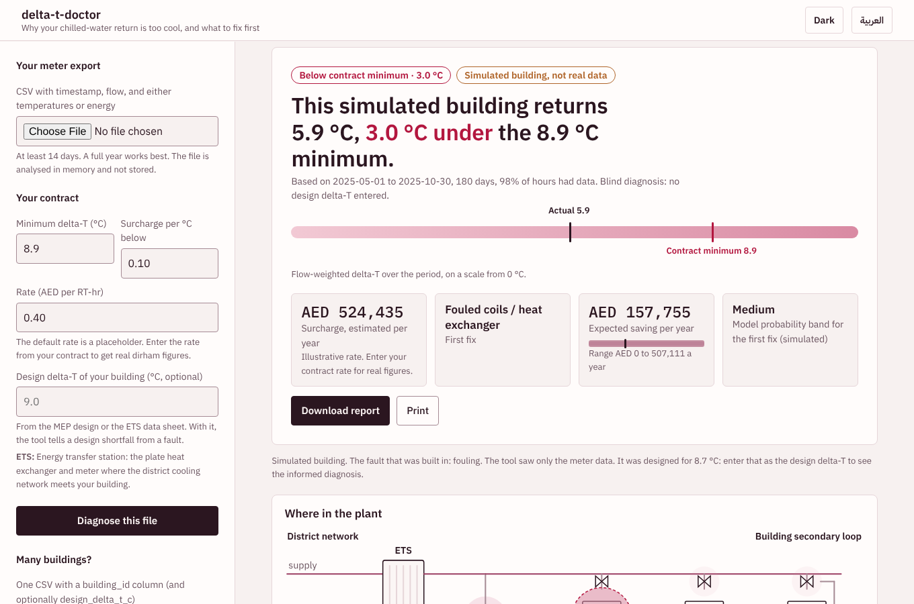

# delta-t-doctor

**Find out why a district-cooled building returns water that is too cool, and which fix to try first, using only the utility meter data it already has.**



> **Status: a research prototype validated in simulation.** Trained and tested on a physics simulator.
> It has **not** been validated on real UAE building data, and one prediction in the external check failed
> (see [Results](#results) and [Limitations](docs/LIMITATIONS.md)). Treat its output as a ranked inspection list.

Product plan, market research and roadmap: [plan.md](plan.md). Draft pilot protocol: [docs/PILOT.md](docs/PILOT.md).

## The problem

District cooling supplies chilled water to buildings through an energy transfer station (ETS). The
plant is sized for the water coming back warm. When a building returns it too cool, the plant moves more water for
the same cooling. This is called low delta-T syndrome. Operators put the burden on the building owner: for
example, Emicool's published FAQ says the owner must maintain a delta-T of 8.9 C, with a surcharge of **10% on the
consumption charge for each degree Celsius below it** ([source](https://www.emicool.com/en/faq)). Contracts
vary.

The owner sees the surcharge on a bill but not the cause. Typical causes are fouled coils, leaking valves on
idle air handlers, 3-way valves that pass full flow, and excess differential pressure. Finding which one applies
is a consultant-led site survey. I found no self-serve tool that does this from meter data.

## What it does

Upload a CSV from the ETS meter (timestamp, flow, supply and return temperature or energy, optionally outdoor
temperature). You get:

1. **Penalty calculator**: delta-T against your contract minimum, month by month, and an annual surcharge estimate.
2. **Fault-signature classifier**: the probability that each of four causes is materially present.
3. **Savings ranking**: causes ordered by expected AED per year recovered, with what to check on site.
4. **Open benchmark**: the simulator, labels and evaluation scripts, so the approach can be tested and criticised.

## How it works

```
meter CSV -> hourly canonical frame -> 42 scale-free shape features -> calibrated gradient boosting -> ranked report
```

Real buildings come without root-cause labels, so training data come from a simulator (effectiveness-NTU coil
model, four fault families, four building types). Ground truth is a **counterfactual**: remove one cause,
simulate again, and the delta-T difference is that cause's gain. Details: [docs/METHODOLOGY.md](docs/METHODOLOGY.md).

## Results

All simulated, 4000 samples across 400 buildings, 5-fold CV grouped by building
(full tables: [results/metrics.md](results/metrics.md)).

| model | macro AUROC | any-fault AUROC | macro F1 | fix #1 gain captured* |
|---|---|---|---|---|
| **delta-t-doctor** | **0.974** | **0.998** | **0.862** | **0.973** |
| logistic regression | 0.945 | 0.991 | 0.791 | 0.921 |
| hand-written expert rules | 0.601 | 0.685 | 0.363 | 0.389 |
| class prior | 0.479 | 0.482 | 0.000 | 0.536 |

\*Share of the achievable delta-T gain recovered by fixing the tool's top-ranked cause, without access to the true fault list.

Under stress (3x sensor noise, 2-hour data, +/-3 C climate, no outdoor temperature, energy-only meter,
21-day window) macro AUROC stays between 0.947 and 0.982. Leaving out a whole building type costs the most
(hotel: 0.931). Those are still simulator results.

**External check (LBNL chiller-plant benchmark, CC-BY).** I wrote predictions before running it
([docs/EXTERNAL_CHECK.md](docs/EXTERNAL_CHECK.md)). Outcome:

* **P1 failed.** A fault-free plant that is *designed* for about 2.6 C delta-T was flagged as faulty. The model
  has only seen buildings designed for 9-13 C and misreads a low-design plant as a badly fouled one. The tool
  now warns when average delta-T is below 4 C.
* **P2** (plant-side faults should not change the verdict) passed only technically, because the score was
  saturated.
* **P3** (pressure-sensor bias raises "overflow") was not supported.
* I also found and fixed a supply/return mapping bug in my own first run and kept the discarded log.

That dataset has no building-side labels, so it cannot measure accuracy. It exposed a real limit.

## Quick start

```bash
pip install -e ".[api,dev]"
deltat-doctor serve                         # web app on http://127.0.0.1:8000
deltat-doctor simulate --causes fouling --out demo_ets.csv
deltat-doctor diagnose demo_ets.csv --rate 0.40
pytest                                      # 36 tests
```

Reproduce the data, model and evaluation: `make data train evaluate` (the data step takes several minutes).
The external check needs the LBNL zip placed under `external/`: `make lbnl`.

## Repository layout

```
src/deltat_doctor/   sim/ (simulator), features, models, penalty, diagnose, io, api, cli, web/
scripts/             generate_data, train, evaluate, lbnl_check
tests/               unit and API tests
docs/                METHODOLOGY, LIMITATIONS, EXTERNAL_CHECK
results/             metrics.md/json, figures, logs
```

## Limitations

Short version: simulator-only validation, four causes, designed-low-delta-T plants out of range, the demo
rate is a placeholder. Full list: [docs/LIMITATIONS.md](docs/LIMITATIONS.md).

## Sources

* Emicool FAQ, delta-T surcharge: https://www.emicool.com/en/faq
* Granderson et al., LBNL FDD datasets, chiller plant: https://fdddata.lbl.gov (CC-BY)
* Background on low delta-T syndrome: Grundfos and ACR Latinoamerica explainers; PolyU fault-diagnosis paper.

## Licence

MIT.
