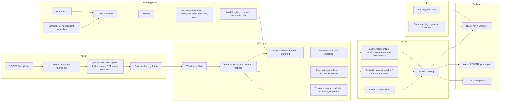

# Engineering plan: limitations, root causes, architecture and upgrade rounds

Written 2026-10-10 against v1.0.0. Evidence for every claim below is in `results/` (run `scripts/error_analysis.py`,
`scripts/evaluate.py`, `scripts/lbnl_followup.py`) or `docs/EXTERNAL_CHECK.md`.

## 1. Limitations register

Severity: **S1** can make the tool wrong in a way a user will not notice; **S2** reduces accuracy or trust; **S3** reduces
usability or maintainability.

| # | Limitation | Sev | Evidence |
|---|---|---|---|
| L1 | **Simulator-only, and circular.** The same physics model generates the data and defines the labels | S1 | No field data. External check has no building-side labels |
| L2 | **Closed world.** Four causes. A fifth cause is forced into the nearest one, with a confident number | S1 | By construction (softmax-free but still four heads, no reject option) |
| L3 | **Out of range guard is crude.** Counts features outside a 1-99% box. It was built after the LBNL failure and has never seen real ETS data | S1 | LBNL: 9 of 42 out of range in the cooling season; box test ignores correlations between features; mitigated in v1.1 by a Mahalanobis guard (`openset.py`), still untested on real data |
| L4 | **Scope: variable flow building loops behind an ETS.** Constant flow systems, plant-side loops and chiller plants are out of scope | S2 | LBNL false alarm (p_any 1.00 fault free) |
| L5 | **Multi-fault degradation.** Exact-match falls from 0.86 (one cause) to 0.38 (two) and 0.05 (three) | S2 | `results/error_analysis.json` |
| L6 | **Weak faults are missed.** Recall at p>=0.5 for true gains of 0.2-0.4 C: passing valves 0.29, overflow 0.29, fouling 0.52 | S2 | same |
| L7 | **Overflow is barely identifiable.** Recall plateaus at 0.77 even for gains above 1.6 C. It looks like passing and constant flow valves in meter data | S2 | AUROC 0.92 at v1.1 (0.953 at v1.0); same file |
| L8 | **Building-type gap.** Held out type: hotel 0.930, residential 0.939, mall 0.958, office 0.965; in-sample slices hotel 0.946 vs office 0.983 | S2 | `results/metrics.md` section C |
| L9 | **No time dimension.** 30-day windows are scored independently. No onset, trend or season-aware view | S2 | by design |
| L10 | **Savings are point estimates with no uncertainty, and per cause gains overlap** | S2 | `penalty.py`, portfolio note |
| L11 | **One tariff shape.** Linear percent-per-degree on a single rate. No tiers, caps, bonuses or capacity charges | S2 | `penalty.py` |
| L12 | **Ingestion trusts the data.** No spike or flatline cleaning, no time-zone or DST handling, no sensor-bias check, units guessed from headers | S1 | `io.py` |
| L13 | **No explanation.** The tool says what, not why. Engineers cannot check the claim against the data | S2 | report and UI |
| L14 | **Service hardening.** No auth, rate limiting, request logging or metrics. Heavy compute runs inside an async handler and blocks the event loop | S2 | `api.py` |
| L15 | **No governance.** No model registry metadata, data lineage, audit trail in outputs, or drift monitoring | S2 | `models.py`, reports |
| L16 | **Evaluation lacked statistics.** Bootstrap intervals, seed replication and ablation added in v1.1; no learning curves or significance tests yet | S2 | `scripts/evaluate.py` |
| L17 | **Synthetic Dubai weather, no humidity.** Latent (dehumidification) load is a main driver of Gulf cooling demand and is not modelled | S2 | `sim/weather.py` |
| L18 | **UI.** English only, no right to left layout, no time view, no uncertainty display, limited accessibility checking | S3 | `web/index.html` |

## 2. Why these gaps and regressions happen

**Root cause A: the label is defined by the model.** Everything the classifier knows comes from one simulator written by one person. A
classifier trained on it learns the simulator's fingerprints (L1, L3, L4, L8, L17). Widening the design delta T range in v0.2 is the
visible example of a regression from this: macro AUROC fell from 0.974 to 0.967 (the two runs also differ in dataset size, so the comparison is indicative only) because low-design buildings have less delta T
headroom, so a fault moves the signature less (false alarms 13% at design 5-7 C against 3% at 9-11 C, v1.1 data).
*Tackle:* a structurally different second simulator, a cross simulator experiment (train on one, test on the other), domain randomisation,
and a labelled-data path for the pilot.

**Root cause B: a classification head cannot say "none of these".** Four heads always return four numbers (L2, L3, L5). The guard
bolted on later looks at features one at a time, so it misses combinations that never occur together in training.
*Tackle:* a density model over the whole feature vector for abstention, an explicit "unexplained" outcome, and evidence the user can
check.

**Root cause C: a weak signal meets a hard threshold.** A cause is "present" if fixing it recovers 0.20 C. Faults near that line
have almost no signature (L6) and 15-24% of all errors sit within 0.1 C of the cutoff. Two faults at once each recover less (L5).
Overflow shares its low load flow signature with two other causes (L7), so meter data alone cannot separate them.
*Tackle:* report calibrated probabilities with intervals instead of hard labels, say which extra data (valve position, pump DP) would
resolve an ambiguity, and use more multi-cause training mass.

**Root cause D: the system was built as a model, not a service.** Cleaning, units, auth, observability, lineage and audit are missing
(L12, L14, L15, L16, L18).
*Tackle:* the rounds below.

## 3. System architecture

Design rules: the inference path is pure and stateless; every output carries model version, data hash and parameters; the
training plane never ships anything to production without a registry entry and a passing evaluation gate.

## 4. Upgrade rounds

Each round: a separate review pass criticises the current code and docs from a stated viewpoint; I turn the criticism into a
checklist, implement it, and verify with tests and measurements. Items I decide not to do are listed with the reason.

| Round | Viewpoint | Main workstreams |
|---|---|---|
| 1 | Machine learning engineering | Evaluation rigour (CIs, slices, ablation, ECE), code quality gates, reproducibility, non blocking service |
| 2 | Defence grade deployment | Robustness to corrupted inputs, quality gate, offline and hardened deployment, performance budget |
| 3 | Research methodology | Uncertainty, second simulator and cross simulator generalisation, research-grade write-up |
| 4 | Government digital service | Arabic and right to left, executive summary, audit trail, accessibility, UI rebuild |
| 5 | Applied research | Evidence-based explanation, open set abstention, physics-informed checks |
| 6 | Senior engineering | Whole-system review, regression run, final polish |

The viewpoints are review personas written by the author. No organisation reviewed or endorsed this work.

## 5. Exit criteria for the programme

* Every S1 limitation has a mitigation that is tested, or is stated plainly in the product as out of scope.
* Measured effect of each upgrade is recorded (before and after) in `CHANGELOG.md`.
* No claim in the README or UI that the evidence does not support.
* Test suite, CI and a clean-environment install pass.
